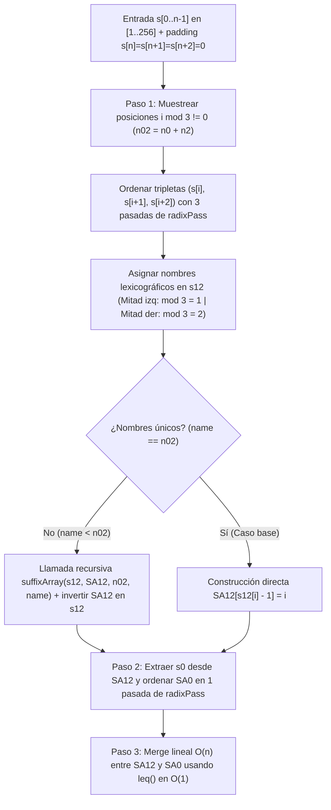
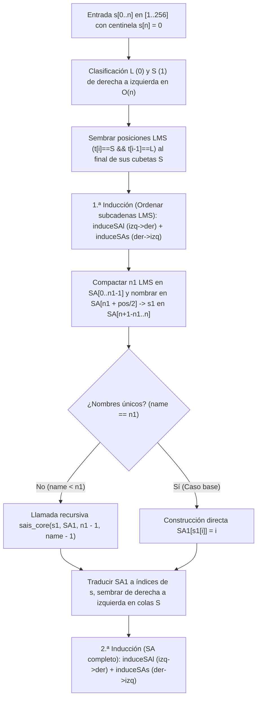
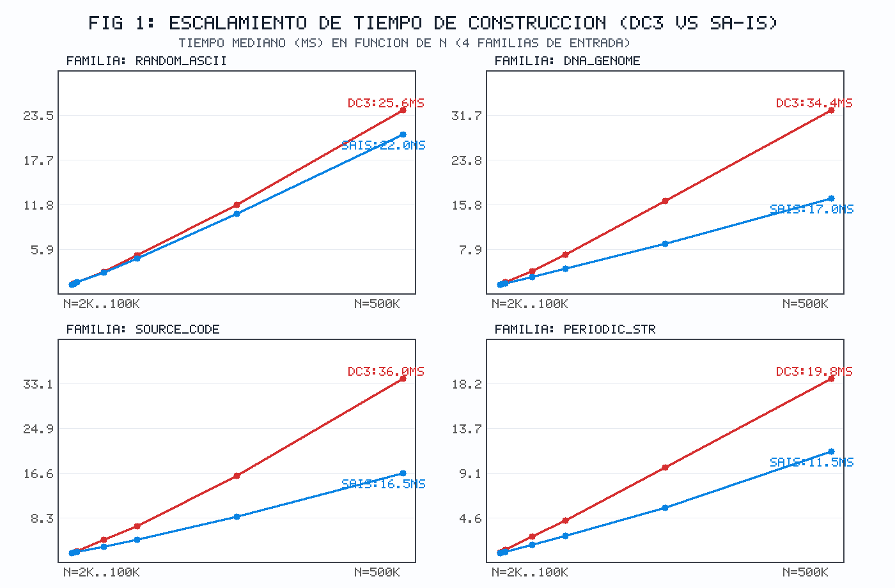
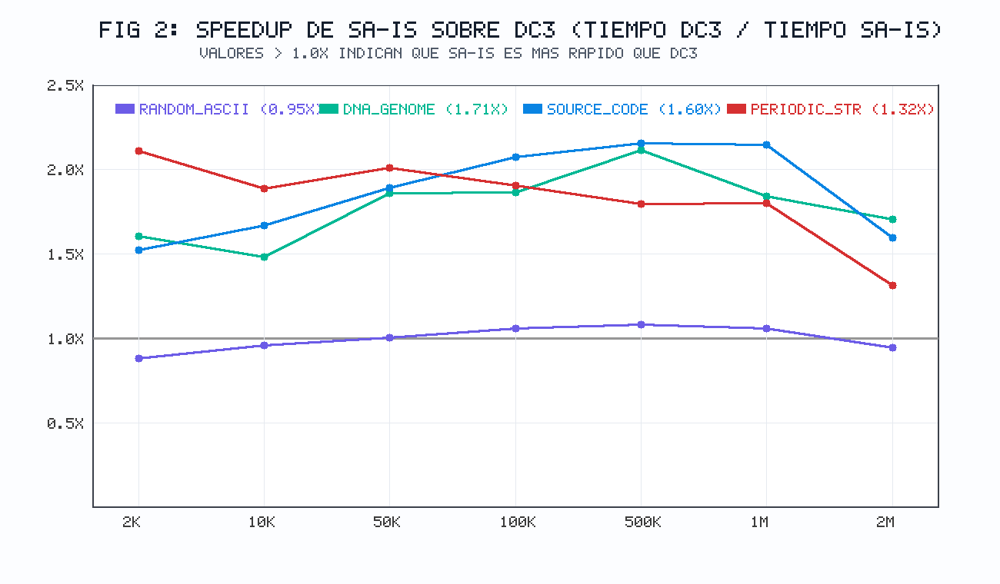
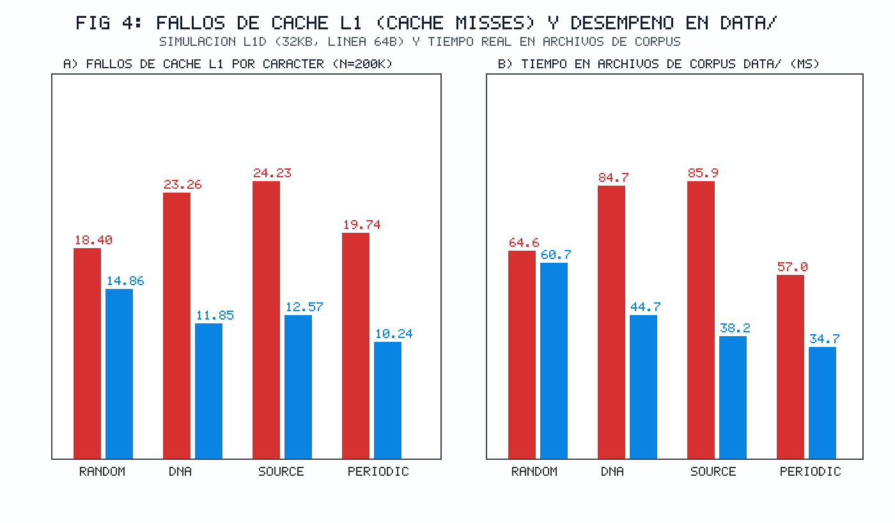

# Construcción en Tiempo Lineal de Arreglos de Sufijos mediante los Algoritmos DC3 y SA-IS: Análisis Teórico, Adaptación en C++17 y Evaluación Experimental de Memoria y Localidad de Caché

**Curso:** CS3014 Estructuras de Datos Avanzadas · Proyecto de Curso I (UTEC 2026-2)  
**Repositorio:** `ProyectoEDA`

---

## Resumen (*Abstract*)

Los **Arreglos de Sufijos** (*Suffix Arrays*, $SA$) constituyen una estructura fundamental de indexación de texto completo en bioinformática, compresión de datos sin pérdida (transformada de Burrows-Wheeler y FM-index) y preprocesamiento léxico en compiladores. Aunque durante más de una década su construcción directa requirió tiempo superlineal $\mathcal{O}(n \log n)$, el desarrollo de algoritmos lineales $\mathcal{O}(n)$ demostró que es posible prescindir de la construcción intermedia de un Árbol de Sufijos. En este informe se presenta el análisis teórico, la adaptación en C++17 y la evaluación experimental de dos de los algoritmos lineales más representativos de la literatura: **DC3 / Skew** (Kärkkäinen & Sanders, 2003), fundamentado en cubiertas de diferencias módulo 3 y ordenamiento por conteo (*Radix Sort*), y **SA-IS** (Nong, Zhang & Chan, 2009), fundamentado en clasificación de sufijos $L/S$, muestreo de subcadenas *Leftmost S-type* (LMS) y ordenamiento inducido (*Induced Sorting*). Nuestras implementaciones adaptan las versiones de referencia del Apéndice A de Kärkkäinen & Sanders (2003) y de Nong et al. (2009) a C++17 con gestión segura de memoria, soporte para el alfabeto binario completo `[0..255]` (mediante desplazamiento `+1` al rango `[1..256]` con centinela `0`) e instrumentación analítica. Evaluamos ambos métodos frente a un generador ingenuo $\mathcal{O}(n^2 \log n)$ sobre cuatro familias de datos (texto aleatorio uniforme, genomas de ADN, código fuente C++ orientado al preprocesamiento léxico y analizadores sintácticos $LR(1)$, y cadenas periódicas) escalando hasta $n = 2{,}000{,}000$ caracteres, archivos de corpus de $1\text{ MB}$ y un simulador de jerarquía de caché L1D (32 KB, 8 vías, líneas de 64 B) y L2 (256 KB). Los resultados muestran que en entradas aleatorias uniformes (donde la recursión termina en profundidad 1) ambos algoritmos tienen tiempos similares ($\text{Speedup} \approx 0.95\times\text{--}1.09\times$), mientras que en textos estructurados o con repeticiones SA-IS alcanza un *speedup* de **$1.32\times$ a $2.25\times$**, ahorra entre **$26\%$ y $43\%$ del espacio analítico total en vectores `int` de 32 bits** ($38\%\text{--}43\%$ en textos estructurados para $n = 2{,}000{,}000$, y entre **$44\%$ y $65\%$ en memoria auxiliar `peak_aux_kb`**) y genera hasta **$1.96\times$ menos fallos de caché L1 por carácter**.

**Palabras Clave:** Arreglo de Sufijos (*Suffix Array*), Tiempo Lineal $\mathcal{O}(n)$, Algoritmo DC3 / Skew, Algoritmo SA-IS, Ordenamiento Inducido (*Induced Sorting*), Subcadenas LMS, Localidad de Caché, Preprocesamiento Léxico y Parsers $LR(1)$.

---

## 1. Introducción y Motivación

### 1.1. El Problema de Indexación de Texto Completo
Sea $\Sigma$ un alfabeto totalmente ordenado y $S = S[0]S[1]\dots S[n-1]$ una cadena de longitud $n$ sobre $\Sigma$, a la cual se concatena conceptualmente un carácter centinela único $S[n] = \$ \notin \Sigma$ tal que $\$ < c$ para todo $c \in \Sigma$. Denotamos por $S_i = S[i\dots n]$ al sufijo que inicia en la posición $i \in \{0, 1, \dots, n-1\}$. El **Arreglo de Sufijos** $SA[0\dots n-1]$ es la permutación única de $\{0, 1, \dots, n-1\}$ que satisface:

$$S_{SA[0]} < S_{SA[1]} < \dots < S_{SA[n-1]}$$

A diferencia de los Árboles de Sufijos (*Suffix Trees*), que si bien pueden construirse en tiempo $\mathcal{O}(n)$ mediante los algoritmos de Weiner, McCreight, Ukkonen o Farach consumen entre $10n$ y $20n$ bytes de memoria debido a los punteros de nodos y aristas, el Arreglo de Sufijos requiere únicamente $4n$ bytes para almacenar la permutación de salida (un entero de 32 bits por carácter).

### 1.2. De $\mathcal{O}(n^2 \log n)$ a $\mathcal{O}(n)$ y su Aplicación en Preprocesamiento Léxico y Sintáctico
La construcción ingenua de $SA$ ordenando los $n$ sufijos mediante un algoritmo basado en comparaciones (`std::sort`) realiza $\mathcal{O}(n \log n)$ comparaciones de cadenas, cada una de costo $\mathcal{O}(n)$ en el peor caso, degradándose a $\mathcal{O}(n^2 \log n)$ cuando existen prefijos comunes largos (como ocurre en código fuente con bloques repetidos o secuencias genómicas). En el contexto de herramientas de compilación, indexar archivos de código fuente como insumo para detección de patrones repetidos, autocompletado de símbolos y apoyo al preprocesamiento léxico y analizadores sintácticos (*parsers*) $LR(1)$ se beneficia tanto de la **complejidad temporal lineal $\mathcal{O}(n)$** como de una **menor huella en memoria caché**.

---

## 2. Marco Teórico y Algoritmos Implementados

### 2.1. Algoritmo DC3 / Skew (Kärkkäinen & Sanders, 2003)

El algoritmo DC3 (*Difference Cover modulo 3*) explota el hecho de que el conjunto $D = \{1, 2\}$ forma una **cubierta de diferencias módulo 3**: para cualesquiera dos posiciones $i, j$, siempre existe un desplazamiento $\Delta \in \{0, 1, 2\}$ tal que tanto $(i + \Delta) \bmod 3 \in \{1, 2\}$ como $(j + \Delta) \bmod 3 \in \{1, 2\}$.

1. **Tamaños por residuo y el sufijo *dummy* cuando $n \bmod 3 = 1$:**
   Definimos $n_0 = \lfloor(n+2)/3\rfloor$, $n_1 = \lfloor(n+1)/3\rfloor$, $n_2 = \lfloor n/3 \rfloor$ y $n_{02} = n_0 + n_2$. Cuando $n \bmod 3 = 1$, hay un sufijo más con residuo $0$ que con residuo $1$ ($n_0 - n_1 = 1$). Como el último sufijo múltiplo de 3 ($i = n - 1$) necesita apoyarse en su sucesor $S_n$ (con residuo $n \bmod 3 = 1$) para poder ser ordenado en el Paso 2, el bucle de muestreo recorre hasta $i < n + (n_0 - n_1)$, insertando la tripleta ficticia $(0, 0, 0)$ en $i = n$.
2. **Ordenamiento de tripletas y mapeo en `s12`:**
   Las $n_{02}$ tripletas $(s[i], s[i+1], s[i+2])$ se ordenan en $\mathcal{O}(n + K)$ mediante tres llamadas estables a `radixPass` con punteros desplazados `s + 2`, `s + 1` y `s`. A continuación, se asignan nombres lexicográficos $name \in [1, n_{02}]$:
   * Si $\text{SA12}[i] \bmod 3 == 1$, el nombre se escribe en la mitad izquierda: `s12[SA12[i] / 3] = name`.
   * Si $\text{SA12}[i] \bmod 3 == 2$, el nombre se escribe en la mitad derecha: `s12[SA12[i] / 3 + n0] = name`.
3. **Resolución de `SA12` y arreglo inverso $\overline{SA}^{12}$:**
   Si $name < n_{02}$, hubo tripletas idénticas y se invoca recursivamente `suffixArray(s12, SA12, n02, name)`, invirtiendo luego `SA12` sobre `s12` mediante `s12[SA12[i]] = i + 1`. Si $name == n_{02}$, los nombres en `s12` ya son los rangos inversos únicos y `SA12` se genera directamente con `SA12[s12[i] - 1] = i`.
4. **Ordenamiento de `SA0` y Fusión (*Merge*) en $\mathcal{O}(1)$ por comparación:**
   Cada sufijo $S_{3k}$ ($i \bmod 3 = 0$) se expresa como $(s[3k], S_{3k+1})$. Como $S_{3k+1}$ vive en el índice $k < n_0$ de `s12`, basta filtrar `if (SA12[i] < n0) s0[j++] = 3 * SA12[i]` y ejecutar **una sola pasada** `radixPass(s0, SA0, s, n0, K)`. Finalmente, el `merge` inicializa el cursor $t = n_0 - n_1$ (descartando el *dummy* en `SA12[0]` si $n \bmod 3 = 1$) y compara $S_i \in SA^{12}$ contra $S_j \in SA^0$ en tiempo constante $\mathcal{O}(1)$:
   * **Caso $i \bmod 3 = 1$ (`SA12[t] < n0`):** Avanza $1$ carácter y compara pares `leq(s[i], s12[SA12[t] + n0], s[j], s12[j / 3])`, ya que tanto $i+1 \equiv 2$ como $j+1 \equiv 1 \pmod 3$ están en `s12`.
   * **Caso $i \bmod 3 = 2$ (`SA12[t] >= n0`):** Avanza $2$ caracteres (porque $i+1 \equiv 0 \pmod 3$ no está en `s12`) y compara tripletas `leq(s[i], s[i+1], s12[SA12[t] - n0 + 1], s[j], s[j+1], s12[j / 3 + n0])`, donde $i+2 \equiv 1$ y $j+2 \equiv 2 \pmod 3$.

---

### 2.2. Algoritmo SA-IS (Nong, Zhang & Chan, 2009)

SA-IS reemplaza la división aritmética fija por una partición estructural basada en las transiciones locales de la cadena $s[0\dots n]$ terminada en el centinela $s[n] = 0$:

1. **Clasificación $L/S$ y Subcadenas LMS (Lema 2.1):**
   Un barrido de $i = n - 1$ hacia $0$ con $t[n] = \text{S}$ asigna $t[i] = \text{S}$ si $s[i] < s[i+1]$, $t[i] = \text{L}$ si $s[i] > s[i+1]$, y $t[i] = t[i+1]$ si empatan. Una posición $i > 0$ es **LMS** si $t[i] == \text{S} \land t[i-1] == \text{L}$. Como $i = 0$ nunca es LMS y jamás pueden existir dos posiciones LMS adyacentes, el número de elementos LMS cumple:
   $$n_1 \le \left\lfloor \frac{n + 1}{2} \right\rfloor$$
   En textos con caracteres independientes y equiprobables (Teorema 3.2), la distancia esperada entre dos LMS es $3$, reduciendo el problema en promedio a $\mathbb{E}[n_1 / n] \approx 1/3$.
2. **Estructura de Cubetas y Motor de Inducción (`induceSAl` e `induceSAs`):**
   Dentro de la cubeta de cualquier carácter $c$, todo sufijo tipo L es lexicográficamente menor que todo sufijo tipo S (pues el primer carácter distinto tras la racha de $c$'s es $< c$ en un sufijo L y $> c$ en un sufijo S). Por ello, `induceSAl` barre `SA` de izquierda a derecha ($0 \to n$) insertando $j = \text{SA}[i] - 1$ (si $t[j] == \text{L}$) en la cabeza de su cubeta (`bkt[s[j]]++`), e `induceSAs` barre de derecha a izquierda ($n \to 0$) insertando $j = \text{SA}[i] - 1$ (si $t[j] == \text{S}$) en la cola de su cubeta (`bkt[s[j]]--`).
3. **Nombramiento con el desplazamiento `pos / 2` y reutilización in-place de `SA`:**
   Tras la primera inducción, los $n_1$ índices LMS se compactan en `SA[0..n1-1]`. Se comparan subcadenas LMS adyacentes verificando tanto `s[pos + d]` como `t[pos + d]` hasta el siguiente LMS inclusive. Como dos posiciones LMS nunca son consecutivas, dividir su coordenada entre 2 (`pos / 2`) permite escribir su nombre en `SA[n1 + pos / 2]` en orden posicional sin colisiones y sin alojar arreglos adicionales para `s1`, compactando luego `s1` en `SA[n + 1 - n1 .. n]`.

---

### 2.3. Comparativa Teórica de Recurrencias y Constantes Ocultas

| Propiedad Teórica | Algoritmo DC3 / Skew (2003) | Algoritmo SA-IS (2009) |
| :--- | :--- | :--- |
| **Recurrencia Temporal** | $T(n) = T(\lceil 2n/3 \rceil) + \mathcal{O}(n)$ | $T(n) \le T(\lfloor n/2 \rfloor) + \mathcal{O}(n)$ ($\approx T(n/3) + \mathcal{O}(n)$ medio) |
| **Factor de Serie Geométrica $\sum \alpha^k$** | $\frac{1}{1 - 2/3} = \mathbf{3.0n}$ (cuando recursa a fondo) | $\le \frac{1}{1 - 1/2} = 2.0n$ peor caso; $\approx \frac{1}{1 - 1/3} = \mathbf{1.5n}$ típico |
| **Razón de Reducción ($\alpha$)** | Determinista: $\frac{2}{3} \approx \mathbf{0.667}$ | Adaptativa: $\le 0.500$ (observada: $\mathbf{0.304\text{--}0.381}$) |
| **Reservas Dinámicas por Nivel** | 4 vectores nuevos (`s12`, `SA12`, `s0`, `SA0`) + `c` | 2 vectores (`t`, `bkt`); **`s1` y `SA1` reutilizan `SA` in-place** |
| **Patrón de Acceso a Memoria** | 4 pasadas de *Radix Sort* con saltos indirectos `r[a[i]]` | Barrido secuencial de `SA[i]` + accesos indirectos `s[SA[i]-1]`, `t[SA[i]-1]` |

---

## 3. Arquitectura de Software y Metodología Experimental

### 3.1. Origen del Código de Referencia y Adaptaciones en C++17
Las implementaciones de DC3 y SA-IS de este proyecto están **basadas directamente en los algoritmos de referencia publicados en el Apéndice A de Kärkkäinen & Sanders (2003) y en la Sección 2 de Nong, Zhang & Chan (2009)**, adaptadas a **C++17** con las siguientes mejoras de ingeniería:
1. **Soporte para el alfabeto binario completo `[0..255]` (incluyendo bytes nulos `\0`):** En los envoltorios públicos [`eda::build_dc3_sa`](../src/dc3.cpp#L217-L255), [`eda::build_sais_sa`](../src/sais.cpp#L186-L231) y [`eda::string_to_int_with_sentinel`](../include/naive_sa.hpp#L75-L83), cada byte `str[i]` se transforma mediante `static_cast<int>(static_cast<unsigned char>(str[i])) + 1` al rango `[1, 256]` con `K = 256`. Esto reserva el valor `0` exclusivamente para el centinela explícito `$` (`s[n] = 0`) y el padding final (`s[n] = s[n+1] = s[n+2] = 0`), evitando que cadenas con bytes `\0` embebidos colisionen con el centinela.
2. **Reemplazo de `new[]`/`delete[]` crudos por `std::vector<int>` (RAII):** Se eliminaron las reservas manuales de punteros crudos del código C original para garantizar seguridad ante excepciones y ausencia de fugas de memoria.
3. **Suite de Pruebas ([`tests/test_runner.cpp`](../tests/test_runner.cpp)):** Incluye `#undef NDEBUG` antes de `<cassert>` para garantizar que las aserciones permanezcan activas incluso en compilaciones `Release` (`-DNDEBUG`). Verifica todas las trazas intermedias de ambos papers (`"mississippi"`, `"mmiississippii"`, `"mmiissiissiippii"`, `"bananas"`), 35 casos deterministas (incluyendo cadenas con bytes `\0` al inicio, al medio, al final, múltiples `\0\0` consecutivos y los 256 valores de byte `[0..255]`) y **1,000 cadenas binarias aleatorias con `\0`**, comprobando la identidad exacta `SA-IS == DC3 == Naive SA` y el verificador [`eda::verify_suffix_array`](../include/naive_sa.hpp#L93-L133).

### 3.2. Entorno de Hardware y Metodología de Medición
Todas las pruebas de rendimiento se ejecutaron sobre el siguiente entorno:
* **Hardware y Sistema Operativo:** **Windows 11 x86_64**, procesador **AMD Ryzen 7 7435HS** (con **16 MB de caché L3**) y **24 GB de memoria RAM**.
* **Compilador y Banderas:** `g++ 14.2.0` (MinGW-w64 / MSYS2) con `-std=c++17 -O3 -Wall -Wextra -Wpedantic`.

En [`bench/benchmark.cpp`](../bench/benchmark.cpp) se instrumentaron tres familias de métricas cuya interpretación metodológica se define con precisión:
* **Tiempo de ejecución (`ms`):** Tiempo de reloj (*wall-clock*) medido con `std::chrono::steady_clock` ejecutando 1 corrida de calentamiento (*warm-up* y verificación activa `assert(sa_dc3 == sa_sais)`) seguida de 5 repeticiones independientes de las cuales se reportan la **mediana** y la **media**.
* **Memoria Analítica de Vectores (`B/char` en 32 bits), Memoria Auxiliar (`peak_aux_kb`) y Proyección Compacta (`Compact B/char`):**
  * `dc3_bytes_per_char` y `sais_bytes_per_char` contabilizan de forma **analítica exacta** el pico de bytes reservados simultáneamente por los vectores `std::vector<int>` del algoritmo a lo largo del árbol recursivo (`size() * sizeof(int)`), dividido entre $n$, mientras que `dc3_peak_aux_kb` y `sais_peak_aux_kb` reportan específicamente la memoria auxiliar adicional a los arreglos base `s` y `SA`. En nuestra implementación, el arreglo de tipos `t` en [`src/sais.cpp`](../src/sais.cpp#L46) se almacena como `std::vector<int> t(n + 1)` por claridad pedagógica y velocidad de acceso en C++.
  * `sais_compact_bpc` reporta una **proyección teórica** de la misma ejecución recursiva partiendo de una base de nivel 0 de $1\text{ B/char}$ (`s` como `uint8_t`) $+ 4\text{ B/char}$ (`SA` como `int32_t`) $+ 0.125\text{ B/char}$ (`t` empaquetado a $1\text{ bit/char}$, `(n + 8) / 8` bytes) $= 5.125\text{ B/char}$, más los vectores `t` en bits de los niveles recursivos y el vector `bkt` activo.
  * Adicionalmente, al finalizar el ejecutable se consulta el `PeakWorkingSetSize` del proceso mediante la API de Windows (`GetProcessMemoryInfo` en `psapi.h`, compilada bajo `#ifdef _WIN32`, la cual devuelve `0` en Linux).
* **Simulador de Jerarquía de Caché ([`CacheHierarchySimulator`](../bench/benchmark.cpp#L47-L142)):** Modela por software una caché de datos **L1D de 32 KB** (64 conjuntos $\times$ 8 vías, líneas de 64 bytes = 16 `int`s por línea) y **L2 de 256 KB** (512 conjuntos $\times$ 8 vías) con política de reemplazo LRU exacta.

---

## 4. Resultados Experimentales y Discusión Crítica

### 4.1. Escalamiento del Tiempo de Construcción ($n = 2{,}000$ a $n = 2{,}000{,}000$)

La Tabla 1 resume los tiempos medianos de construcción (en milisegundos) extraídos de [`results/benchmark_metrics.csv`](../results/benchmark_metrics.csv) para las 4 familias sintéticas desde $n = 2{,}000$ hasta $n = 2{,}000{,}000$:

| Familia | $n$ | Naive (ms) | DC3 (ms) | SA-IS (ms) | Speedup (DC3 / SA-IS) | Profundidad (DC3 / SA-IS) | Razón Reducción (DC3 / SA-IS) |
| :--- | ---: | ---: | ---: | ---: | :---: | :---: | :---: |
| **`random_ascii`** | $10{,}000$ | $1.68$ | $0.63$ | $0.66$ | $0.96\times$ | $1 / 1$ | $0.667 / 0.329$ |
| **`random_ascii`** | $100{,}000$ | --- | $7.06$ | $6.67$ | $1.06\times$ | $1 / 1$ | $0.667 / 0.330$ |
| **`random_ascii`** | $500{,}000$ | --- | $40.26$ | $37.10$ | $1.09\times$ | $1 / 1$ | $0.667 / 0.331$ |
| **`random_ascii`** | $1{,}000{,}000$ | --- | $59.53$ | $56.00$ | $1.06\times$ | $1 / 1$ | $0.667 / 0.331$ |
| **`random_ascii`** | $2{,}000{,}000$ | --- | $147.12$ | $155.18$ | $0.95\times$ | $1 / 1$ | $0.667 / 0.331$ |
| **`dna_genome`** | $10{,}000$ | $2.07$ | $0.72$ | $0.48$ | $1.48\times$ | $3 / 3$ | $0.667 / 0.356$ |
| **`dna_genome`** | $100{,}000$ | --- | $6.81$ | $3.65$ | $1.86\times$ | $4 / 3$ | $0.667 / 0.355$ |
| **`dna_genome`** | $500{,}000$ | --- | $40.90$ | $19.33$ | $\mathbf{2.12\times}$ | $4 / 4$ | $0.667 / 0.355$ |
| **`dna_genome`** | $1{,}000{,}000$ | --- | $82.72$ | $44.87$ | $1.84\times$ | $4 / 4$ | $0.667 / 0.355$ |
| **`dna_genome`** | $2{,}000{,}000$ | --- | $194.85$ | $114.19$ | $\mathbf{1.71\times}$ | $4 / 4$ | $0.667 / 0.355$ |
| **`source_code`** | $10{,}000$ | $1.81$ | $0.58$ | $0.34$ | $1.67\times$ | $3 / 3$ | $0.667 / 0.335$ |
| **`source_code`** | $100{,}000$ | --- | $6.62$ | $3.19$ | $2.08\times$ | $4 / 3$ | $0.667 / 0.336$ |
| **`source_code`** | $500{,}000$ | --- | $37.58$ | $17.43$ | $\mathbf{2.16\times}$ | $4 / 4$ | $0.667 / 0.337$ |
| **`source_code`** | $1{,}000{,}000$ | --- | $79.35$ | $36.98$ | $\mathbf{2.15\times}$ | $4 / 4$ | $0.667 / 0.337$ |
| **`source_code`** | $2{,}000{,}000$ | --- | $189.16$ | $118.42$ | $\mathbf{1.60\times}$ | $4 / 4$ | $0.667 / 0.337$ |
| **`periodic_str`** | $10{,}000$ | $\mathbf{183.66}$ | $0.65$ | $0.34$ | $1.89\times$ | $8 / 3$ | $0.667 / 0.308$ |
| **`periodic_str`** | $500{,}000$ | --- | $21.59$ | $12.01$ | $1.80\times$ | $11 / 3$ | $0.667 / 0.308$ |
| **`periodic_str`** | $1{,}000{,}000$ | --- | $46.04$ | $25.52$ | $\mathbf{1.80\times}$ | $12 / 3$ | $0.667 / 0.308$ |
| **`periodic_str`** | $2{,}000{,}000$ | --- | $95.76$ | $72.66$ | $1.32\times$ | $\mathbf{13 / 3}$ | $0.667 / 0.308$ |

**Hallazgos clave del escalamiento temporal:**
1. **Degradación cuadrática de `Naive` ante repeticiones:** En `random_ascii` ($n = 10{,}000$), dos sufijos aleatorios difieren en sus primeros $1\text{--}2$ caracteres y `build_naive_sa` tarda solo $1.68\text{ ms}$. Sin embargo, en `periodic_str` ($n = 10{,}000$), los sufijos comparten prefijos idénticos de miles de caracteres, elevando el tiempo de `Naive` a **$183.66\text{ ms}$** ($540\times$ más lento que los $0.34\text{ ms}$ de SA-IS).
2. **Paridad en `random_ascii` (`Depth = 1`) vs. ventaja de SA-IS en textos estructurados (`Depth = 4`):**
   * En `random_ascii` ($\lvert\Sigma\rvert = 64$), ambos algoritmos terminan en **profundidad recursiva 1** (2 niveles totales: $k = 0$ y $k = 1$), mostrando un rendimiento muy parejo ($\text{Speedup} \approx 0.95\times\text{--}1.09\times$).
   * En cambio, en `dna_genome` y `source_code` para $n \ge 500{,}000$, ambos algoritmos alcanzan **`Depth = 4` (es decir, 5 niveles totales desde $k = 0$ hasta $k = 4$)**. A lo largo de estos 5 niveles, DC3 ejecuta **20 llamadas a `radixPass` y 5 fases de `merge`** con un volumen acumulado de $\sum_{k=0}^{4} (2/3)^k \approx 2.605n$ ($\to 3.0n$ asintótico). Por el contrario, SA-IS reduce el problema con $\alpha \approx 0.355$ en `dna_genome` (acumulando $\sum_{k=0}^{4} 0.355^k \approx 1.542n$) y con $\alpha \approx 0.337$ en `source_code` (acumulando $\sum_{k=0}^{4} 0.337^k \approx 1.502n$), lo que explica su ventaja de **$1.60\times\text{ a }2.16\times$**.
3. **Efecto del desborde de la caché L3 (16 MB) entre $n = 1{,}000{,}000$ y $n = 2{,}000{,}000$:**
   Aunque el número de operaciones aritméticas y accesos a memoria de ambos algoritmos escala de manera estrictamente lineal $\mathcal{O}(n)$, al duplicar $n$ de $1\text{M}$ a $2\text{M}$ el tiempo físico se multiplica por un factor de $2.08\times\text{ a }3.20\times$. Esto responde a la jerarquía de memoria del Ryzen 7 7435HS: en $n = 1{,}000{,}000$, buena parte del espacio de trabajo de SA-IS ($\sim 14.1\text{ MB}$) cabe dentro de los **16 MB de caché L3**, mientras que en $n = 2{,}000{,}000$ el espacio de trabajo ($\sim 28.2\text{ MB}$ en SA-IS y $\sim 46.4\text{ MB}$ en DC3) rebasa la caché L3 y debe servirse desde la memoria principal DRAM, cuya latencia es mayor.

---

### 4.2. Análisis de *Speedup* y Desempeño en los Corpus de $1\text{ MB}$ en `data/`

Al evaluar los 4 archivos de corpus de $1{,}000{,}000\text{ bytes}$ generados en `data/` ([`results/corpus_benchmark.csv`](../results/corpus_benchmark.csv)), obtenemos:

| Archivo de Corpus (`data/`) | Tamaño $n$ | $\lvert\Sigma\rvert$ | DC3 (ms) | SA-IS (ms) | Speedup | Profundidad (D/S) | Reducción (D / S) | Memoria B/char (DC3 / SAIS 32b / Proy. Comp.) |
| :--- | ---: | :---: | ---: | ---: | :---: | :---: | :---: | :---: |
| `data/corpus_random.txt` | $1{,}000{,}000$ | $64$ | $64.61$ | $60.75$ | $1.06\times$ | $1 / 1$ | $0.667 / 0.331$ | $19.63 / 14.35 / 6.20$ |
| `data/corpus_dna.fasta` | $1{,}000{,}000$ | $4$ | $84.72$ | $44.65$ | $\mathbf{1.90\times}$ | $4 / 3$ | $0.667 / 0.347$ | $23.21 / 13.96 / 5.29$ |
| `data/corpus_source_code.txt` | $1{,}000{,}000$ | $95$ | $85.92$ | $38.19$ | $\mathbf{2.25\times}$ | $5 / 5$ | $0.667 / \mathbf{0.304}$ | $23.47 / 13.99 / 5.25$ |
| `data/corpus_periodic.txt` | $1{,}000{,}000$ | $10$ | $57.01$ | $34.74$ | $1.64\times$ | $12 / 8$ | $0.667 / 0.381$ | $23.97 / 14.46 / 5.20$ |

**Análisis del desempeño en código fuente (`corpus_source_code.txt`, $n = 1{,}000{,}000$) y contraste con la propuesta:**
El archivo `corpus_source_code.txt` combina el código fuente real del repositorio con módulos C++ variados orientados al preprocesamiento léxico y analizadores sintácticos (*parsers*) $LR(1)$ (funciones de transición parametrizadas, tablas de estados y estructuras AST). Cabe precisar que la evaluación experimental se realizó sobre este corpus de código fuente C++ como insumo representativo de un *front-end* de compilador, sin integrar el Suffix Array dentro de un lexer o parser en producción. En este tipo de texto estructurado, las rachas de espacios de indentación, palabras reservadas (`namespace`, `inline`, `static constexpr`, `return`) e identificadores producen secuencias monótonas de tipos $L$ y $S$ que elevan la longitud media de las subcadenas LMS a $\approx 3.29$ caracteres, comprimiendo el primer subproblema recursivo al **$30.4\%$ del tamaño original ($n_1 / n = 0.304$)** frente al **$66.7\%$ fijo de DC3**. Con una profundidad de $5$ niveles en ambos algoritmos, SA-IS completa la construcción en **$38.19\text{ ms}$ frente a $85.92\text{ ms}$ de DC3 ($2.25\times$ más rápido)**.

---

### 4.3. Consumo de Memoria RAM, Profundidad de Recursión y Razón de Reducción

1. **Huella de Memoria Analítica (`B/char` en 32 bits), Memoria Auxiliar (`peak_aux_kb`) y Proyección Compacta:**
   * En espacio de trabajo analítico total de 32 bits (`dc3_bytes_per_char` vs. `sais_bytes_per_char`), en $n = 2{,}000{,}000$ **DC3 requiere entre $19.19\text{ B/char}$** (`random_ascii`, profundidad 1) **y $23.98\text{ B/char}$** (`periodic_str`, profundidad 13), mientras que **SA-IS requiere entre $13.64\text{ y }14.44\text{ B/char}$**. Considerando todos los tamaños y familias evaluadas, el ahorro de SA-IS en memoria analítica total es del **$26\%\text{ al }43\%$ global** (**$38\%\text{--}43\%$ en textos estructurados para $n = 2{,}000{,}000$** y $33\%\text{--}43\%$ en todo el rango de textos estructurados).
   * Si analizamos exclusivamente la **memoria auxiliar en el heap (`peak_aux_kb`)** en $n = 2{,}000{,}000$ (excluyendo los arreglos de entrada/salida base `s` y `SA`), SA-IS reduce el pico auxiliar entre un **$44\%$ en `random_ascii`** ($12{,}222\text{ KB}$ vs. $21{,}851\text{ KB}$) y un **$65\%$ en `periodic_str`** ($11{,}018\text{ KB}$ vs. $31{,}202\text{ KB}$), ya que `s1` y `SA1` reutilizan el propio arreglo `SA` in-place.
   * En la **proyección teórica del modelo compacto** (`sais_compact_bpc`, partiendo de una base de nivel 0 de $1 + 4 + 0.125 = 5.125\text{ B/char}$), el consumo proyectado es de **$5.18\text{ a }6.10\text{ B/char}$ en $n = 2{,}000{,}000$** (y de $5.18\text{ a }6.49\text{ B/char}$ incluyendo los tamaños pequeños desde $n = 2{,}000$).
2. **Ley $\lfloor \log_3 n \rfloor$ de Profundidad Recursiva de DC3 en Cadenas Periódicas (`D = 13` vs `D = 3` en $n = 2{,}000{,}000$):**
   En `periodic_str`, la cadena repite un patrón fijo de 39 caracteres, por lo que el prefijo común más largo (LCP) entre sufijos desplazados por un período es de orden $\approx n$. Dado que en el nivel recursivo $d$ cada símbolo de DC3 solo abarca una ventana de **$3^d$ caracteres**, DC3 sigue encontrando empates mientras $3^d < n$, haciendo que su profundidad recursiva siga exactamente la ley **$\lfloor \log_3 n \rfloor$**: para $n \in \{2{,}000,\; 10{,}000,\; 50{,}000,\; 100{,}000,\; 500{,}000,\; 1{,}000{,}000,\; 2{,}000{,}000\}$, $\lfloor \log_3 n \rfloor$ produce exactamente las profundidades observadas **$6, 8, 9, 10, 11, 12\text{ y }13$** ($3^{13} = 1{,}594{,}323 \approx 1.59\text{M}$). En cambio, las subcadenas LMS de SA-IS capturan la estructura periódica con $\alpha = 0.308$ y resuelven todos los empates en solo **3 niveles recursivos**.

---

### 4.4. Localidad Espacial y Fallos de Caché L1/L2 (*Cache Misses*)

La Tabla 3 presenta las métricas obtenidas con nuestro simulador de jerarquía de caché (`CacheHierarchySimulator`, L1D de 32 KB y L2 de 256 KB con líneas de 64 B) en $n = 200{,}000$ ([`results/cache_metrics.csv`](../results/cache_metrics.csv)):

| Distribución ($n = 200{,}000$) | Accesos Indirectos DC3 | Accesos Indirectos SA-IS | Fallos L1 / char DC3 (Tasa %) | Fallos L1 / char SA-IS (Tasa %) | Ratio Fallos L1 (DC3 / SA-IS) | Ratio Fallos L2 (DC3 / SA-IS) |
| :--- | :---: | :---: | :---: | :---: | :---: | :---: |
| **`random_ascii`** | $53.24\%$ | $35.72\%$ | $18.40$ ($33.28\%$) | $14.86$ ($24.85\%$) | $1.24\times$ | $1.39\times$ |
| **`dna_genome`** | $54.92\%$ | $36.54\%$ | $23.26$ ($27.76\%$) | $11.85$ ($17.31\%$) | $\mathbf{1.96\times}$ | $\mathbf{1.67\times}$ |
| **`source_code`** | $55.47\%$ | $36.22\%$ | $24.23$ ($29.21\%$) | $12.57$ ($19.05\%$) | $\mathbf{1.93\times}$ | $\mathbf{1.67\times}$ |
| **`periodic_str`** | $57.18\%$ | $36.31\%$ | $19.74$ ($21.67\%$) | $10.24$ ($16.70\%$) | $\mathbf{1.93\times}$ | $\mathbf{1.42\times}$ |

**Interpretación arquitectónica:**
En SA-IS, aunque el barrido principal sobre `SA[i]` en `induceSAl` e `induceSAs` es secuencial, la inspección de `t[SA[i]-1]` y `s[SA[i]-1]` constituye un acceso indirecto aleatorio (representando $\approx 35.7\%\text{--}36.5\%$ del total de accesos en SA-IS). Sin embargo, en DC3 los accesos indirectos `r[a[i]]` durante las 4 pasadas de `radixPass` por nivel y el `merge` alcanzan entre el $52.0\%$ y el $57.2\%$ en todo el rango evaluado ($53.24\%\text{--}57.18\%$ en $n = 200{,}000$). Como consecuencia, en $n = 200{,}000$ DC3 genera **`1.24x` más fallos L1 por carácter en `random_ascii`** y casi el doble (**`1.93x–1.96x` más fallos L1** y **`1.42x–1.67x` más fallos L2**) **en textos estructurados (`dna_genome`, `source_code`, `periodic_str`)**, lo cual explica directamente la ventaja en tiempo de reloj de SA-IS sobre estas distribuciones.

---

## 5. Conclusiones y Recomendaciones Prácticas

1. **Balance empírico entre DC3 y SA-IS:** Ambos algoritmos cumplen rigurosamente su cota temporal lineal $\mathcal{O}(n)$. Cuando la entrada es aleatoria uniforme de alta entropía (`random_ascii`) y la recursión se detiene en el nivel 1, el rendimiento temporal de ambos métodos es prácticamente equivalente ($\text{Speedup} \approx 0.95\times\text{--}1.09\times$). Cuando la entrada presenta estructura léxica, alfabetos pequeños o repeticiones (`dna_genome`, `source_code`, `periodic_str`), la menor razón de reducción de SA-IS ($\approx 0.304\text{--}0.381$ frente a $0.667$) y su reutilización de memoria in-place le otorgan una ventaja de **$1.32\times\text{ a }2.25\times$ en velocidad**, un ahorro de **$38\%\text{--}43\%$ en espacio analítico total de 32 bits** en $n = 2{,}000{,}000$ ($26\%\text{--}43\%$ global) y de **$44\%\text{--}65\%$ en memoria auxiliar (`peak_aux_kb`)**.
2. **Idoneidad para Preprocesamiento Léxico y Sintáctico:** En el corpus de código fuente C++ de $1\text{ MB}$ (`corpus_source_code.txt`), evaluado como insumo representativo para herramientas de preprocesamiento léxico y parsers $LR(1)$, SA-IS logró una razón de reducción de $n_1 / n = 0.304$ y un *speedup* de **$2.25\times$** sobre DC3.
3. **Vigencia de DC3 en Arquitecturas Paralelas y Memoria Externa:** La principal fortaleza estructural de DC3 reside en que sus fases de muestreo, *Radix Sort* de tripletas, sumas prefijas y fusión son altamente paralelizables (**Data-Parallel**) en **GPU** y **PRAM/BSP** (Teorema 2 de Kärkkäinen & Sanders, 2003), mientras que los barridos `induceSAl` e `induceSAs` de SA-IS poseen una dependencia secuencial inherente ($SA[i] \to SA[i]-1$). En el ámbito de **memoria externa (*External Memory*)**, DC3 fue el algoritmo pionero, aunque posteriormente también se formularon variantes de ordenamiento inducido para disco como **eSAIS** (Beller et al., 2013).

---

## 6. Referencias Bibliográficas

1. Kärkkäinen, J., & Sanders, P. (2003). *Simple linear work suffix array construction.* En **Automata, Languages and Programming (ICALP 2003)**, Lecture Notes in Computer Science, vol. 2719, pp. 943–955. Springer.
2. Nong, G., Zhang, S., & Chan, W. H. (2009). *Linear suffix array construction by almost pure induced-sorting.* En **2009 Data Compression Conference (DCC 2009)**, pp. 193–202. IEEE.
3. Manber, U., & Myers, G. (1993). *Suffix arrays: a new method for on-line string searches.* **SIAM Journal on Computing**, 22(5), 935–948.
4. Ko, P., & Aluru, S. (2003). *Space efficient linear time construction of suffix arrays.* En **Combinatorial Pattern Matching (CPM 2003)**, LNCS 2676, pp. 200–210. Springer.
5. Beller, T., Berger, M., Ohlebusch, E., & Startup, S. (2013). *External memory suffix array construction.* **Journal of Discrete Algorithms**, 23, 12–21.
